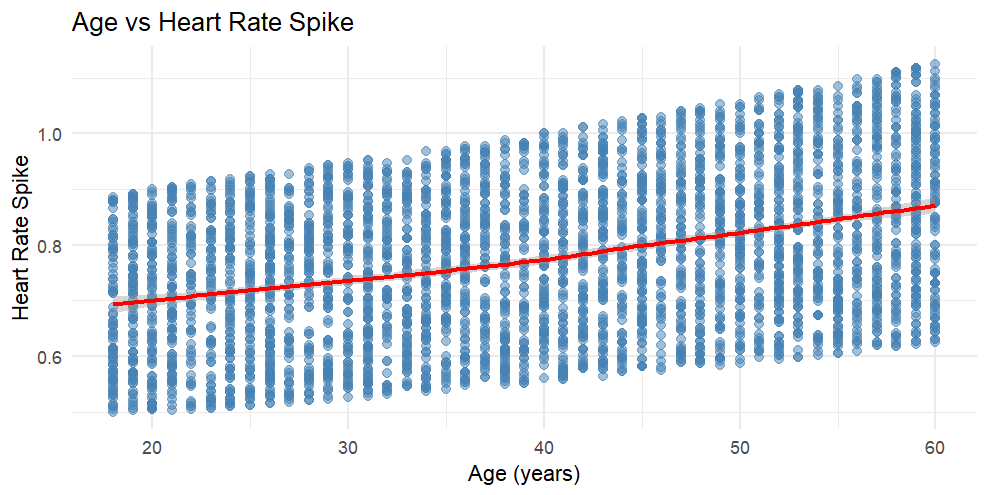
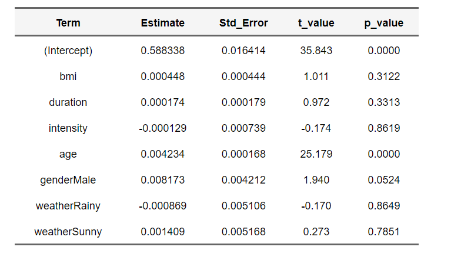
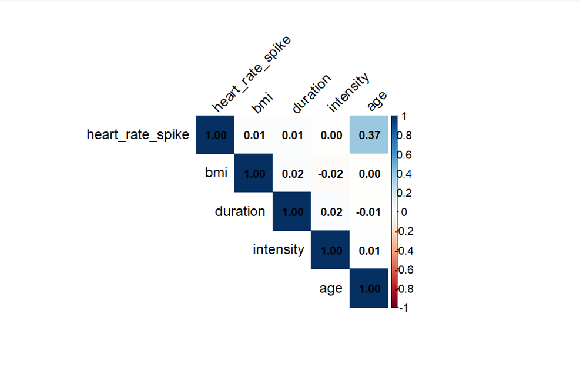
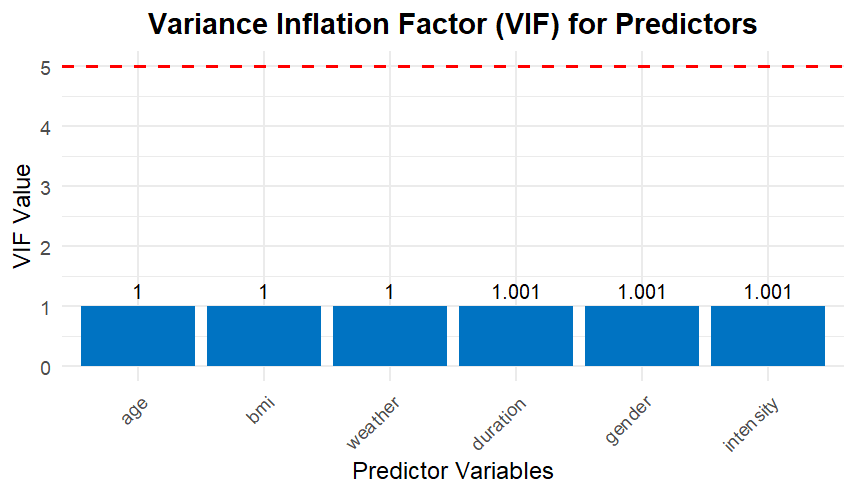
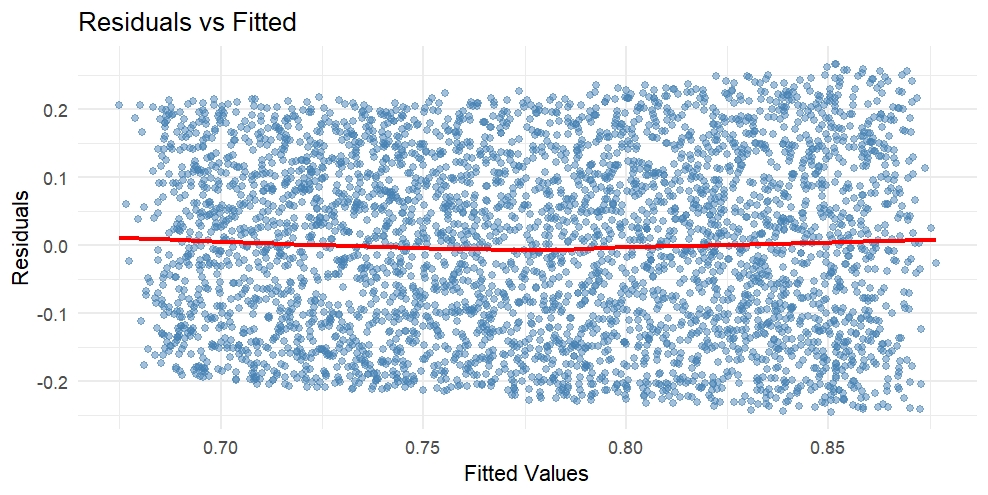

# Predicting Exercise Overexertion Risk (Heart Rate Spike) with Multiple Linear Regression in R

**Team project by:** Sharon Rosina Wamalwa and Simon Kanya
**Course:** DSCI 724 – Data Mining for Managers, University of South Dakota
**Tools:** R (tidyverse, janitor, psych, GGally, corrplot, car, flextable, ggfortify)



---

## Business problem

Overexertion during exercise can cause dizziness, abnormal heart-rate spikes, early fatigue and, for vulnerable people, extra cardiac stress. Gyms, coaches and fitness apps need a simple way to flag higher-risk sessions using data they already collect (age, BMI, session length, intensity).

This project builds a multiple linear regression model to predict **heart_rate_spike**, a normalized measure of how close a person gets to their age-adjusted maximum heart rate, and identifies which factors drive it. The results can support:

- in-workout safety alerts (for example, "dial down intensity"),
- personalized duration and intensity targets, and
- post-session feedback to reduce future risk.

## Data

- **Source:** [Exercise and Fitness Metrics Dataset (Kaggle)](https://www.kaggle.com/datasets/aakashjoshi123/exercise-and-fitness-metrics-dataset)
- **Size:** about 3,864 exercise sessions, 12 variables
- **Fields used:** heart rate, age, BMI, duration (minutes), exercise intensity (1–10), gender, weather conditions

### Response variable

```
heart_rate_spike = heart_rate / (220 - age)
```

`220 - age` is the standard estimate of maximum heart rate. A value of 0.80 means the person reached 80% of their expected maximum.

### Predictors

| Variable | Type | Description |
|---|---|---|
| bmi | Numeric | Body Mass Index |
| duration | Numeric | Session length in minutes |
| intensity | Numeric (1–10) | Self-reported exercise intensity |
| age | Numeric | Age in years |
| gender | Categorical | Male / Female |
| weather | Categorical | Cloudy / Rainy / Sunny |

## Methods

1. **Data preparation:** cleaned column names, created `heart_rate_spike`, converted gender and weather to factors.
2. **Exploratory analysis:** descriptive statistics, boxplots (Tukey five-number summary), Pearson correlation matrix and heatmap.
3. **Base model:** `lm(heart_rate_spike ~ bmi + duration + intensity + age + gender + weather)`.
4. **Interaction terms:** age × intensity, duration × intensity, BMI × intensity, compared to the base model with an ANOVA F-test.
5. **Non-linear terms:** quadratic and log versions of the numeric predictors.
6. **Diagnostics:** residuals vs fitted, normal Q-Q, scale-location, residuals vs leverage.
7. **Multicollinearity:** Variance Inflation Factor (VIF) on the main-effects model.

## Key results

### Base model fit

| Metric | Value |
|---|---|
| R² | 0.1419 |
| Adjusted R² | 0.1403 |
| RMSE | 0.13069 |
| MAE | 0.11317 |
| AIC | –4742.45 |



- **Age** is the only strong predictor (coefficient 0.004234, p < 0.001; correlation r = 0.37). Each extra year of age raises heart_rate_spike by about 0.004.
- **Gender** is borderline (males slightly higher, p = 0.052).
- **BMI, duration, intensity and weather** are not significant (all p > 0.31).
- Self-reported **intensity** has almost no link to heart_rate_spike (r = –0.0007), which suggests self-ratings may not reflect real physical strain.

### Model comparison

| Model | R² | Adj. R² | RMSE | AIC |
|---|---|---|---|---|
| Base (final) | 0.1419 | 0.1403 | 0.13069 | –4742.45 |
| + Quadratic terms | 0.1432 | 0.1407 | 0.13059 | –4740.32 |
| + Log terms | 0.1430 | 0.1406 | 0.13060 | –4739.50 |

- **Interactions:** the ANOVA test was not significant (p = 0.056). Only duration × intensity was significant on its own (p = 0.011), but its effect was very small (–0.000159).
- **Non-linear terms:** no quadratic or log term was significant at 0.05, and AIC got worse, so they were left out.
- **Final model:** main effects only (the base model).

### Diagnostics and multicollinearity

| Correlation heatmap | VIF |
|---|---|
|  |  |

- All VIF values are about 1.0, so there is no multicollinearity.
- Residuals vs fitted is flat (linearity is reasonable); no influential points (no points past Cook's distance).
- The Q-Q plot shows the residual tails are lighter than normal, and variance rises slightly at higher fitted values. With more than 3,800 rows this mainly affects p-values, not predictions.



## Business takeaways

- Age-based guidance is more useful than guidance based on BMI, session length or self-rated intensity in this data.
- Fitness apps should not rely on self-reported intensity alone to judge strain; a measured signal such as heart rate is needed.
- The model explains about 14% of the variation. Fitness level, genetics, sleep and stress are not in the data and likely explain much of the rest.

## Limitations

- **Age appears on both sides of the model.** Age is in the denominator of the response (`220 - age`) and is also a predictor, so much of the age effect is built in by the formula: the same heart rate gives a higher spike for an older person. A next step is to model raw `heart_rate` with age as a predictor, or to use a response that does not contain age, and check whether age still matters.
- The near-zero links between heart rate and intensity, duration and BMI suggest the Kaggle dataset may be simulated. Results should be checked on real wearable data.
- Results are in-sample; a train/test split or cross-validation would give a fairer error estimate.

## Repository structure

```
├── README.md
├── code/
│   └── heart_rate_spike_regression.R
├── data/
│   └── exercise_dataset.csv        (download from Kaggle)
├── images/                         (charts used in this README)
└── report/
    └── heart_rate_spike_report.pdf
```

## How to run

1. Download `exercise_dataset.csv` from the Kaggle link above and save it in `data/`.
2. Open `code/heart_rate_spike_regression.R` in RStudio.
3. Change the `setwd()` line to your project folder, or replace it with `read_csv("data/exercise_dataset.csv")`.
4. Install the packages if needed:

```r
install.packages(c("tidyverse", "janitor", "psych", "GGally", "car",
                   "corrplot", "flextable", "officer", "ggfortify"))
```

5. Run the script from top to bottom.

## Team

| Name | LinkedIn |
|---|---|
| Sharon Rosina Wamalwa | [linkedin.com/in/rosina-sharon](https://www.linkedin.com/in/rosina-sharon) |
| Simon Kanya | [linkedin.com/in/simonkanyamediabuyer](https://www.linkedin.com/in/simonkanyamediabuyer/) |

## Contact

- GitHub: [github.com/ROSINA365](https://github.com/ROSINA365)
- Email: rosinasharon6@gmail.com
